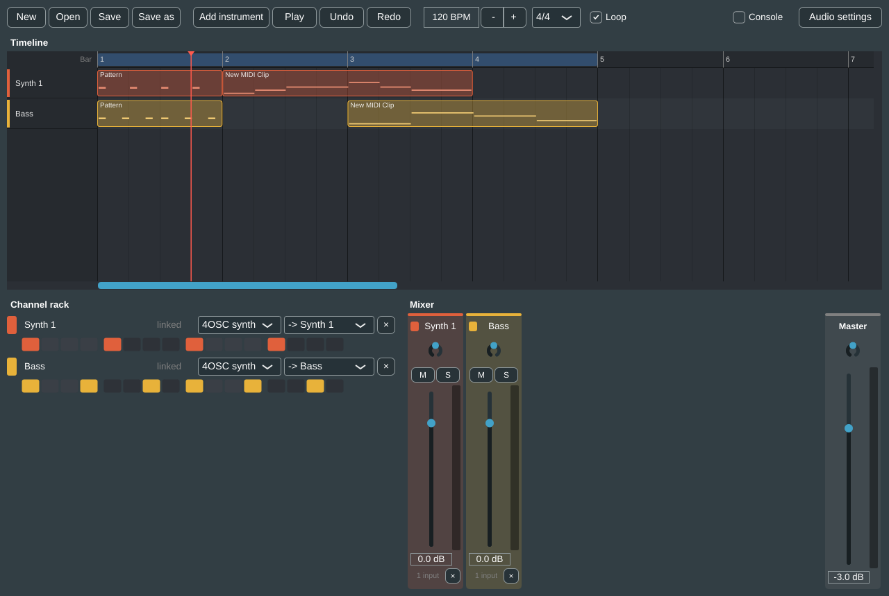

# Ng DAW

A desktop DAW built on [Tracktion Engine](https://github.com/Tracktion/tracktion_engine) and JUCE.
Tracktion does the hard engine work (playback, plugin hosting, the edit model); this project
builds the workflow on top: FL Studio-style flexibility with REAPER/Cubase-style mixer mapping,
and every action available to AI tools through one command layer.



## What's here (v0.1)

- **A window that plays audio.** It opens with one synth (Tracktion's built-in 4OSC) playing a
  four-on-the-floor pattern. *Add instrument*, *Play*, *Undo* and *Redo* all go through the command layer.
  In the channel rack and mixer, double-click a name to rename it, click the colour chip to
  recolour, pick an instrument, or press × to delete.
- **Project files.** *New*, *Open*, *Save* and *Save as* (Ctrl+N, Ctrl+O, Ctrl+S,
  Ctrl+Shift+S) work with `.ngdaw` files, which hold the Tracktion Edit as XML. The title bar
  shows the project name with a `*` while there are unsaved changes, and New, Open and closing
  the app ask whether to save them first.
- **A timeline.** One lane per channel shows its clips (with a small picture of their notes)
  against a bar ruler, with the loop region and the playhead. Click or drag in the ruler to
  move the playhead. Ctrl + mouse wheel zooms, Shift + wheel scrolls through time, and the view
  follows the playhead while playing.
- **Clip editing.** On the timeline, drag a clip to move it (onto another channel's lane too),
  drag its edges to trim it, and double-click an empty spot for a new one-bar clip. Del deletes
  the selected clip, Ctrl+D duplicates it, S splits it at the playhead, and right-click offers
  the same. Drags snap to the beat (16ths when zoomed in); hold Alt to place freely. A step
  pattern can be copied along the timeline, and every copy follows the channel's steps.
- **A piano roll.** Double-click a clip (or select it and press Enter) to edit its notes in
  place of the rack and mixer. Click to draw a note (drag to set its length), drag a note to
  move it and its right edge to resize it; right-click or Del deletes. Ctrl+click and Ctrl+drag
  select several, Ctrl+A selects all, and the arrow keys move the selection (Shift + up/down
  for an octave). Notes snap to the grid picked in Snap (1/4 to 1/32); hold Alt to place freely.
  Under the notes, the velocity lane shows how hard each one plays: click or drag across it to
  set the velocity of the notes there (only the selected ones, if any are). Quantize (or Q)
  moves the selected notes, or all of them, onto the grid. Each edit is one undo step.
- **A step sequencer.** Each channel has a row of 16 steps (16th notes) under its name; click a
  step to turn it on or off. The step under the playhead is outlined while playing.
- **A transport** with Play, back to the start (|< or Home), tempo (type it, click the arrows
  or drag), time signature, the song position (bar.beat.sixteenth), a Loop switch and a
  Metronome that clicks on every beat, louder on the bar. New projects loop the whole project,
  rounded up to whole bars. The loop region shows in the timeline ruler: drag its edges to
  change it, Shift+drag to draw a new one, or right-click to loop a bar or the whole project.
- **MIDI input.** Arm a channel with its ● button in the channel rack, and any MIDI keyboard
  plays it (one channel is armed at a time). No keyboard? Tick Keys for an on-screen one you can
  play with the mouse or the computer keys (A W S E D F T G ...). Rec records what you play into
  the armed channel from the playhead; Rec again or Stop finishes, and the recording becomes a
  clip in one undo step.
- **Keyboard shortcuts.** Space plays and stops, Ctrl+Z undoes, Ctrl+Y (or Ctrl+Shift+Z)
  redoes, R records, C turns the metronome on or off, Ctrl+L looping, Ctrl+T adds an
  instrument and Ctrl+K shows the keyboard. On the timeline, Ctrl+C and Ctrl+V copy a clip and
  paste it at the playhead, the left and right arrows move it by a beat (Shift: a bar), up and
  down move it to the next channel, and Esc deselects. In the piano roll, Ctrl+C, Ctrl+X and
  Ctrl+V copy, cut and paste notes at the playhead, Ctrl+D duplicates them, and Esc closes it.
  F1 or the ? button lists them all.
- **A mixer.** Each strip has a fader, pan, mute, solo and a level meter, with a master strip
  on the right. A whole fader drag is one undo step; mute and solo aren't undo steps, as in
  most DAWs.
- **Linked-by-default mixer strips.** Adding an instrument creates a channel *and* a mixer strip
  with the same name and colour, already routed. Pick a different strip in the channel rack to
  detach it; several channels can share one strip; pick its own strip again to re-link it.
- **A command layer.** Every change is a named command with JSON parameters:

  | Command | What it does |
  | --- | --- |
  | `create_track` | Adds an instrument channel plus its linked mixer strip |
  | `route` | Sends a channel to a strip (or `master`); detaches it if it isn't its own strip |
  | `rename_track` | Renames a channel or strip; a linked pair is renamed together |
  | `set_track_colour` | Recolours a channel or strip; a linked pair changes together |
  | `delete_track` | Deletes a channel (and its own strip, unless shared) or a strip (its inputs go to master) |
  | `set_instrument` | Swaps a channel's instrument (`4osc` or `none` for now) |
  | `set_mixer_strip` | Sets a strip's (or `master`'s) fader, pan, mute and solo |
  | `set_tempo` / `set_time_signature` | Project tempo (clips keep their beats) and time signature |
  | `set_loop` | Loop on/off and the loop region in beats (default: the whole project, in whole bars) |
  | `set_steps` | Sets or toggles a channel's step pattern (`steps`, `step`, `length`, `pitch`) |
  | `add_midi_clip` | Adds a MIDI clip with notes to a channel |
  | `move_clip` / `resize_clip` / `split_clip` / `duplicate_clip` / `delete_clip` | Clip editing, by clip id from `get_state` |
  | `get_notes` / `set_notes` | Reads or replaces a MIDI clip's notes (beats from the clip's start) |
  | `quantize_notes` | Moves a clip's notes (or some of them) onto a grid, optionally with their ends |
  | `play` / `stop` / `set_position` | Transport; `set_position` moves the playhead to a beat |
  | `set_metronome` | Turns the metronome on or off |
  | `arm_channel` / `record` | Arms a channel for MIDI input, and records into it until `stop` |
  | `new_project` / `open_project` / `save_project` | Project files; New and Open refuse to drop unsaved changes unless `discard_changes` is true |
  | `get_state` | The whole project as JSON (channels with their clips in beats, strips, transport), so an AI can "see" the session |

  Each editing command is one undo step, a batch of commands is one undo step, and a failing command
  or batch is rolled back. The command console (tick *Console* in the toolbar) takes the same JSON
  an MCP server will send, for example:

  ```json
  {"command": "route", "params": {"channel": "Synth 2", "strip": "Synth 1"}}
  {"batch": "Two synths", "commands": [
    {"command": "create_track", "params": {"name": "Bass"}},
    {"command": "create_track", "params": {"name": "Lead"}}]}
  ```

## Layout

```
src/core/Session.*            the open project: Tracktion Edit + channel/strip model
src/core/CommandRegistry.*    command specs (name, description, JSON schema, handler)
src/core/CommandDispatcher.*  runs commands, batches, JSON requests, undo/redo
src/core/ProjectCommands.cpp  create_track, route, set_steps, add_midi_clip, play, stop, projects, get_state
src/app/                      the JUCE window (timeline, channel rack, mixer, transport, console)
src/app/MixerView.*           mixer strips: fader, pan, mute/solo, meters, master
src/app/TimelineView.*        the arrangement timeline: lanes, clips, ruler, playhead, zoom
src/app/PianoRoll.*           the piano roll: keyboard, note grid, drawing and editing notes
tests/CommandTests.cpp        headless tests, including an offline render that checks for sound
```

`ng_core` is a static library holding JUCE, Tracktion and the command layer, so the app, the
tests and a future MCP server all share it. `CommandRegistry::describe()` already returns the
commands in MCP `tools/list` shape (name, description, inputSchema), and
`CommandDispatcher::executeJson()` is the call an MCP `tools/call` handler would make.

## Building

Needs CMake 3.22+, a C++20 compiler, and git. CMake downloads Tracktion Engine v3.2.0 and the
JUCE commit it pins on first configure (a few hundred MB; the first build takes a while).

```sh
cmake -B build -DCMAKE_BUILD_TYPE=Debug
cmake --build build -j
ctest --test-dir build --output-on-failure
```

The app ends up in `build/NgDaw_artefacts/Debug/`.

GitHub Actions runs the same build and tests on Windows (MSVC) and Linux (GCC) for every pull
request and every push to `main` (`.github/workflows/ci.yml`).

- **macOS:** Xcode command line tools. `-G Xcode` works too.
- **Windows:** Visual Studio 2022 with the C++ workload. `-G "Visual Studio 17 2022"`.
- **Linux (Debian/Ubuntu):**
  `sudo apt install libasound2-dev libjack-jackd2-dev libfreetype-dev libfontconfig1-dev libx11-dev libxrandr-dev libxinerama-dev libxcursor-dev libcurl4-openssl-dev`

To build against existing checkouts instead of downloading, pass
`-DFETCHCONTENT_SOURCE_DIR_TRACKTION=/path/to/tracktion_engine -DFETCHCONTENT_SOURCE_DIR_JUCE=/path/to/JUCE`.

## Licensing

Tracktion Engine and JUCE are each available under the GPLv3 or a commercial licence.
Releasing this app closed-source needs commercial licences for both.

## Next steps

- An MCP server executable that wraps `CommandRegistry::describe()` and `executeJson()`
- Multi-output instruments getting a folder of strips that sums to one bus
- Tags (`drums`, `bass`, `vox`) that create and route buses automatically
- Plugin scanning and VST3/CLAP instruments, project save/load
