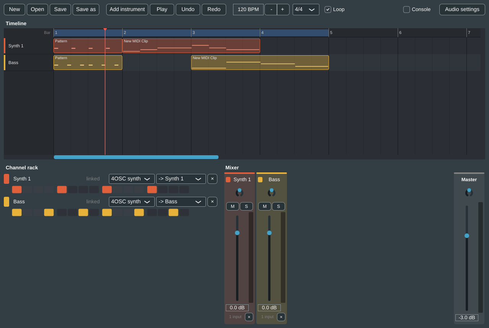

# Ng DAW

A desktop DAW built on [Tracktion Engine](https://github.com/Tracktion/tracktion_engine) and JUCE.
Tracktion does the hard engine work (playback, plugin hosting, the edit model); this project
builds the workflow on top: FL Studio-style flexibility with REAPER/Cubase-style mixer mapping,
and every action available to AI tools through one command layer.



## Features

- **Timeline and patterns:** a lane per channel with MIDI, pattern and audio clips, paint/delete/mute/slice tools, loop region and automation lanes.
- **Piano roll and step sequencer:** with snap, quantize, velocity editing and scale highlighting.
- **Channel rack and mixer:** you can route any channel to any mixer strip. Strips have insert effects, buses, pre-fader sends, multi-output instruments, meters and a master strip.
- **Instruments and plugins:** built-in synths (Tracktion's 4OSC with starter sounds), a sampler with drum kits, and VST3 plugin hosting with plugin windows and presets.
- **Samples and audio:** a sample browser with an indexed search, audio channels with a sample editor and fades, and recording MIDI and audio.
- **Projects:** `.ngdaw` project files, autosave with crash recovery, and full undo/redo with a history panel.
- **Export:** the whole song, the loop region or stems, as WAV or MP3.
- **AI-ready:** every action is a command (75 of them). The `NgDawMcp` server lets Claude drive the open project, and each AI change shows in an AI command log with per-entry undo.

## Installing

Download `NgDaw-<version>-Windows-Setup.exe` from the
[releases page](https://github.com/nicolaigoon/ng-audio/releases) and run it. It installs Ng DAW
and the `NgDawMcp` server, adds a Start menu entry, and can associate `.ngdaw` files with Ng DAW.
On macOS and Linux, build from source.

See [Getting started](docs/user-guide/getting-started.md) for a tour of the app.

## Using it with Claude

With Ng DAW open, add the MCP server to Claude Code:

```sh
claude mcp add ng-daw -- "C:\Program Files\Ng DAW\NgDawMcp.exe"
```

*Settings* > *AI* in the app shows the exact command and Claude Desktop config for your machine.
See [MCP server](docs/mcp.md) and the [command reference](docs/commands.md).

## Building

Needs CMake 3.22+, a C++20 compiler and git. Tracktion Engine and JUCE are downloaded on first configure.

```sh
cmake -B build -DCMAKE_BUILD_TYPE=Debug
cmake --build build -j
ctest --test-dir build --output-on-failure
```

The app ends up in `build/NgDaw_artefacts/Debug/` and the MCP server in `build/NgDawMcp_artefacts/Debug/`.
See [Building](docs/building.md) for platform prerequisites and options, [Testing](docs/testing.md)
and [Releasing](docs/release.md).

## Documentation

All documentation lives in [`docs/`](docs/README.md): the user guide, the command and MCP
reference, and the architecture and developer guides.

## Licensing

Tracktion Engine and JUCE are each available under the GPLv3 or a commercial licence.
Releasing this app closed-source needs commercial licences for both.
