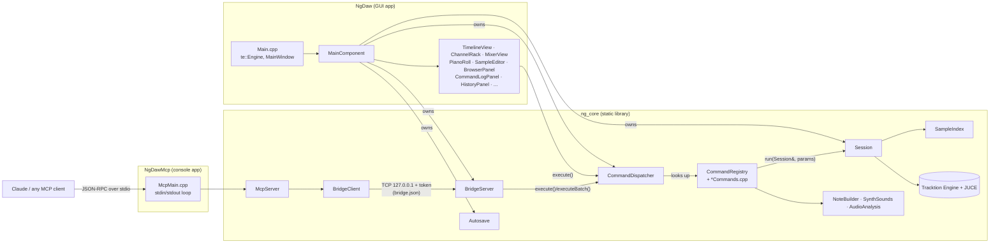
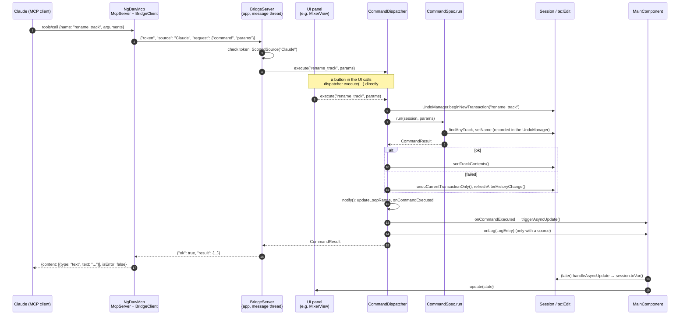

# Architecture

This document describes how Ng DAW is put together: the build targets, the core objects, how a
command gets from a button or an AI client to Tracktion Engine, and how the UI keeps up with the
project. For the full list of commands see [commands.md](commands.md); for the MCP server from a
client's point of view see [mcp.md](mcp.md). The on-disk formats are in
[project-format.md](project-format.md), and [extending.md](extending.md) walks through adding a
command or a panel.

## Goals

- **Tracktion does the engine work.** Playback, plugin hosting, rendering, time-stretching and
  the edit model (tracks, clips, plugins, automation, the undo history) all come from
  [Tracktion Engine](https://github.com/Tracktion/tracktion_engine) v3.2.0 and the JUCE commit it
  pins (`CMakeLists.txt`). Ng DAW doesn't have its own audio graph.
- **Ng DAW builds the workflow on top of it.** It adds an FL Studio-style model of *channels*,
  *strips*, *patterns* and *tags* on top of Tracktion's tracks (`src/core/Session.h`), plus the
  timeline, channel rack, mixer and piano roll UI (`src/app/`).
- **One command layer for everything that changes the project.** Every edit is a named command
  with a JSON Schema for its parameters (`src/core/CommandRegistry.h`). UI buttons, keyboard
  shortcuts, the JSON console, the tests and AI clients over MCP all run the same commands through
  one `CommandDispatcher` (`src/core/CommandDispatcher.h`). That's why "what the UI can do" and
  "what Claude can do" are the same list, and why every change is one undo step no matter who
  made it.

## Build targets

`CMakeLists.txt` defines three targets of our own, plus the test targets when `BUILD_TESTING` is
on (the default with `include(CTest)`):

| Target | Kind | Sources | What it is |
| --- | --- | --- | --- |
| `ng_core` | static library | `src/core/*.cpp` | JUCE and Tracktion compiled once, plus `Session`, the command registry and dispatcher, every `*Commands.cpp`, `Bridge`, `McpServer`, `Autosave`, `SampleIndex`, `AudioAnalysis`, `NoteBuilder` and `SynthSounds`. |
| `NgDaw` | JUCE GUI app (`juce_add_gui_app`) | `src/app/*.cpp` | The desktop app. Links `ng_core`. |
| `NgDawMcp` | JUCE console app | `src/mcp/McpMain.cpp` | The MCP server (stdio). Links `ng_core`, but only uses `McpServer` and `BridgeClient` from it; it never opens a project itself. |
| `NgDawTests` | JUCE console app | `tests/CommandTests.cpp` | Headless tests of the command layer, bridge, MCP server and offline rendering. Links `ng_core`. |
| `NgTestSynth`, `NgTestGain`, `NgTestDrums` | VST3 plugins | `tests/Test*/` | Tiny plugins (an instrument, an effect, a two-output instrument) that the tests scan and load. |

`ng_core` links the JUCE and Tracktion modules `PRIVATE`, so their sources compile into it once,
and then re-exports their include paths and compile definitions (`target_include_directories
(ng_core INTERFACE ...)`, `target_compile_definitions (ng_core INTERFACE ...)`) so that the app,
the MCP server and the tests can include the headers without compiling the modules again.
`NG_VERSION` is defined from `project(NgDaw VERSION ...)` and used by the app and the MCP server.

`CMakeLists.txt` also fetches Rubber Band v4.0.0 and patches Tracktion's
`tracktion_TimeStretch.cpp` at configure time: it switches Rubber Band to its R3 ("finer") engine
and caps how much input the real-time stretcher asks for. See the comments there and
[building.md](building.md) for the build itself.



## Source layout

```
src/core/   the project model and the command layer (no UI): ng_core
src/app/    the JUCE window and its panels: NgDaw
src/mcp/    McpMain.cpp, the NgDawMcp entry point
tests/      CommandTests.cpp and the three test plugins
```

The README's *Layout* section has a one-line description of every file.

## Session

`ng::Session` (`src/core/Session.h`, `src/core/Session.cpp`) is the open project: it owns one
`te::Edit` and gives Ng DAW's view of it. It is constructed with the app's `te::Engine` and
always has an Edit (a new empty one to begin with).

### Ng's model on top of Tracktion

Everything is a Tracktion `AudioTrack`; Ng gives tracks a role, stored as properties on the
track's `ValueTree` state so they are saved with the Edit and take part in its undo history:

- A **channel** (`ngRole="channel"`) holds an instrument (the built-in 4OSC, Tracktion's sampler,
  a VST3/AU plugin, or nothing) and its clips. An *audio channel* (`ngAudio`) holds audio clips
  instead of an instrument.
- A **strip** (`ngRole="strip"`) is a mixer strip: fader, pan, insert effects, sends.
- Creating a channel also creates a strip with the same name and colour and links them
  (`ngOwnStrip`). While a channel feeds its own strip they are *linked*, and renaming or
  recolouring one changes both (`Session::getLinkedPartner`). Routing a channel elsewhere
  detaches it; many channels can feed one strip.
- **Buses** are strips holding an aux return (`Session::getBusNumber`); **tags** group channels
  and route them to a per-tag bus (`ngTag`, `ngTagBus`).
- **Patterns** (FL Studio style) are kept under an `NGPATTERNS` child of the Edit; pattern 1's
  step rows stay on the channels themselves (`ngSteps`, `ngStepPitch`) so older projects open
  unchanged.
- **Multi-output instruments** move the plugin into a Tracktion rack, with one output strip per
  stereo pair (`ngOutputOf`, `ngOutputPair`).

[project-format.md](project-format.md) lists every property Ng adds.

### What Session provides

- **Project lifecycle**: `newProject()`, `openProject()`, `saveProject()`, `writeCopy()` (for
  autosave) and `recoverProject()`. All of them go through the private `adoptEdit()`, which calls
  `onEditAboutToChange` first (so the UI can let go of tracks and plugins), stops the transport,
  re-attaches the change listener, adds a level meter to the master, writes out built-in effects'
  settings (`storeEffectSettings`), removes unused racks, switches audio clips to real-time
  stretching, clears the undo history and marks the project as saved.
- **Unsaved-changes tracking**: a `juce::ValueTree::Listener` (`Session::ChangeListener`) sets an
  atomic flag on any change to the Edit's state, except the ones `getComparableState()` leaves out
  (the playhead, `INPUTDEVICES`, `lastSignificantChange`). Because a change may be put back by
  undo, `checkUnsavedChanges()` compares `getComparableState()` (the Edit as XML) with the state
  recorded at the last save; that's slow, so it's only called after undo, redo, rollback and
  non-undoable commands that might have touched the project.
- **Lookups** used by every command: `findTrack`, `findAnyTrack`, `findClip`, `findEffectList`,
  `findBus`, `findTagBus`, `getInstrument`, `getSampler`, `getNotes` and so on. Commands accept
  ids or names; `findTrack` tries the id first, then the name.
- **Housekeeping that keeps undo working**: `sortTrackContents()` puts each track's children in
  the order Tracktion would sort them into a moment later (as a separate undo step otherwise);
  `writeTrackOutputs()` / `refreshTrackOutputs()` keep Tracktion's "track <n>" output references
  correct after a delete; `refreshAfterHistoryChange()` brings live state (outputs, MIDI and audio
  input routing, fader/pan/effect/send parameters, mute/solo) back in line after undo, redo or a
  rollback, then calls `checkUnsavedChanges()`.
- **Transport-side state that isn't the song**: the armed MIDI channel and armed audio channels
  (not saved, not undone), live MIDI from the on-screen or typing keyboard (`sendLiveMidi`), the
  loop region in beats (`getLoopBeats`, `setCustomLoop`, `updateLoopRange`).
- **`toVar()`**: the whole project as plain data (`channels`, `strips`, `master`, `patterns`,
  `current_pattern`, `transport`, ...). This is what `get_state` returns and what the UI rebuilds
  itself from.
- `getSampleIndex()`: the `SampleIndex` used by `find_samples`.
- `isExporting()` / `setExporting()`: set while `export_audio` renders (see *Threading*).

`ng::EngineBehaviour` (also in `Session.h`) is passed to the `te::Engine`. It overrides
`shouldProcessMutedTracks()` with a static atomic flag that the stem export turns on, so muted
strips still feed their sends while stems render (`src/core/ExportCommands.cpp`).

## The command layer

### CommandRegistry and CommandSpec

`src/core/CommandRegistry.h` defines:

```cpp
struct CommandSpec
{
    juce::String name;          // e.g. "create_track"
    juce::String description;   // shown as the MCP tool's description
    juce::var paramsSchema;     // JSON Schema of the params object (the MCP inputSchema)
    bool undoable = true;       // false for transport, queries, file operations
    std::function<CommandResult (Session&, const juce::var& params)> run;
};
```

and `CommandResult` (`ok`, `value`, `error`, with `success()`, `failure()` and `toVar()`, which
gives `{"ok": true, "result": ...}` or `{"ok": false, "error": "..."}`).

`CommandRegistry` is just a vector of specs: `add()` (asserts the name is unique and `run` is
set), `find(name)`, `getAll()`, and `describe()`, which returns every command as
`{name, description, inputSchema}`, the shape of an MCP `tools/list` entry.

Commands are grouped by area in `src/core/*Commands.cpp`, each with a `register...Commands
(CommandRegistry&)` function declared in `CommandRegistry.h`. `registerProjectCommands()`
(`src/core/ProjectCommands.cpp`) registers its own commands and then calls every other group, so
it is the one function callers use: `MainComponent`'s constructor, `McpServer`'s constructor and
the tests' `Fixture` all call it.

The `params` namespace in `CommandRegistry.h` has the helpers commands use to build schemas
(`schema`, `prop`, `object`) and read parameters (`getString`, `getDouble`, `isNumber`,
`roundBeats`).

### Validation

The dispatcher checks only that the command exists and that `params` is an object (or absent),
and refuses everything but `get_state` during an export (`CommandDispatcher::run`). **The JSON
Schema is not enforced at run time**; it's published to MCP clients so they know what to send.
Each command's `run` function validates its own parameters and returns
`CommandResult::failure ("<command>: <what's wrong>")`, prefixing the message with the command's
name (see `renameTrack` in `src/core/ProjectCommands.cpp`).

### CommandDispatcher

`src/core/CommandDispatcher.h` is the single entry point for changing the project:

- **`execute(name, params)`**: one command, one undo step. If the spec is `undoable` and no
  gesture is open, it calls `UndoManager::beginNewTransaction(name)` first. The command changes
  Tracktion objects, which record their changes in the Edit's `juce::UndoManager`
  (`Session::getUndoManager()` is `edit->getUndoManager()`). After a successful undoable command,
  `Session::sortTrackContents()` runs inside the same transaction. If the command **fails**, the
  dispatcher calls `undoCurrentTransactionOnly()` and `refreshAfterHistoryChange()`, so a failed
  command leaves no trace (and no empty undo step).
- **`executeBatch(label, commands)`**: `[{"command": ..., "params": ...}, ...]` as one undo step
  named `label`. If any command fails, the whole batch is rolled back and the error says which.
  String parameters of the form `"$<n>.<field>"` are replaced by fields of earlier results
  (`"$0.channel"`, `"$2.clips.0.id"`; `"$$"` escapes a literal `$`), which is how an AI creates a
  track and then uses its id in the same batch.
- **`executeJson(json)`**: parses `{"command", "params"}` or `{"batch", "commands"}` and returns
  the result as JSON. The app's console uses this.
- **`beginGesture(label)` / `endGesture()`**: everything executed between them joins one undo
  step, while still applying command by command. Used for drags: the tempo slider
  (`src/app/MainComponent.cpp`), send knobs and new-bus drops (`src/app/MixerView.cpp`), painting
  steps (`src/app/ChannelRack.cpp`), browser drops (`src/app/BrowserPanel.cpp`) and built-in
  effect sliders (`src/app/PluginWindow.cpp`).
- **`undo()` / `redo()`**: call the `UndoManager`, then `refreshAfterHistoryChange()`.

After every command, batch, undo or redo the dispatcher calls `notify()`, which updates the loop
range, re-checks unsaved changes when needed, and calls **`onCommandExecuted(name, result)`**.
That callback is how the app learns that something changed.

Commands with `undoable = false` don't open a transaction. Some still manage the history
themselves: `stop` wraps the clips a recording produces in a `"Record"` transaction
(`src/core/TransportCommands.cpp`), and `new_project` / `open_project` replace the Edit and so
clear the history.

### Logging

The dispatcher has a *source*: who is sending commands right now. `CommandDispatcher::ScopedSource`
sets it for a scope; `BridgeServer` sets it to the MCP client's name (e.g. `"Claude"`), and the
console to `"Console"`. When a source is set, every command, batch, undo and redo (except queries,
whose names start with `get_`, `list_` or `find_`) is passed to **`onLog`** as a `LogEntry`:
source, label, the commands a batch ran, success or error, whether it made an undo step, and the
undo depth and description just after it. UI-initiated commands have no source and aren't logged.

`CommandLogPanel` (`src/app/CommandLogPanel.h`) shows these entries and offers Undo on an entry
while `isLatestUndoStep(entry)` is true, i.e. while its undo step is still the newest one.

## Bridge: the app's side of MCP

`src/core/Bridge.h` connects programs outside the app to the dispatcher of the running app.

- **`BridgeServer`** (in the app, owned by `MainComponent`) is a `juce::InterprocessConnectionServer`
  listening on `127.0.0.1` on a port the OS picks. On `start()` it generates a random 256-bit hex
  token and writes `{port, token, pid}` to the **connection file**, `bridge.json` (location in
  [project-format.md](project-format.md#bridge-connection-file)). On non-Windows systems the file
  is created empty, `chmod 600`'d, then written in place so the token is never readable by other
  users. `stop()` deletes the file only if it still holds this copy's token (another copy of the
  app may have started since).
- Messages use JUCE's `InterprocessConnection` framing with a private magic header (`0x4e674457`,
  "NgDW"), so stray connections from other JUCE apps are ignored. Each message is one JSON object:

  ```json
  {"token": "...", "source": "Claude", "request": {"command": "create_track", "params": {"name": "Bass"}}}
  {"token": "...", "source": "Claude", "request": {"batch": "Bass line", "commands": [ ... ]}}
  {"token": "...", "source": "Claude", "undo": true}
  {"token": "...", "describe": true}
  ```

  `BridgeServer::handleRequest()` checks the token, then runs the request through the app's own
  dispatcher under a `ScopedSource`, and replies with the dispatcher's `{"ok", "result"|"error"}`.
  So AI changes are undone, logged and shown exactly like changes made by hand.
- **`BridgeClient`** (in `NgDawMcp`) reads the connection file, connects, adds the token to each
  request and waits for the reply (up to 10 minutes by default, since exports can be long). It
  sends one request at a time (a static lock), reconnects once if the app was restarted, and
  never resends a request after the connection dropped mid-request, since the app may already
  have run it.
- `NG_DAW_BRIDGE_FILE` overrides the connection file's path for both ends (the tests use it).

## McpServer and NgDawMcp

`src/core/McpServer.h` implements the MCP protocol (JSON-RPC 2.0): `initialize`, `ping`,
`tools/list` and `tools/call`; notifications get no reply. `src/mcp/McpMain.cpp` is just a loop
that feeds each stdin line to `McpServer::handleLine()` and writes the reply to stdout (nothing
else may be written to stdout).

- `McpServer` holds **its own** `CommandRegistry`, filled by `registerProjectCommands()`, used
  only to list tools and to check that a tool name exists. It doesn't have a `Session` or a
  dispatcher; every call goes to the app over the `BridgeClient`.
- `tools/list` returns `registry.describe()` plus three extra tools: `batch`, `undo` and `redo`
  (`McpServer::listTools`).
- `tools/call` turns a tool call into a bridge request, using the client's name from
  `initialize` (`describeClient` maps anything containing "claude" to `"Claude"`) as the source.
  The reply becomes an MCP text result, with `isError` set when the app reports a failure.
- `initialize` negotiates one of the protocol versions `2024-11-05`, `2025-03-26`, `2025-06-18`
  and sends `instructions` telling the model to start with `get_state` and to use `batch`.

Because the MCP executable builds its tool list from its own copy of the registry, the app and
`NgDawMcp` must come from the same build for the tool list to match what the app accepts.
See [mcp.md](mcp.md) for setting up clients.

### A command's journey



## Threading

- **The message thread does all the editing.** Every command runs on JUCE's message thread: UI
  callbacks are there anyway, and the bridge's `Connection` objects are created with
  `callbacksOnMessageThread = true` (`InterprocessConnection (true, magicHeader)` in
  `src/core/Bridge.cpp`), so `messageReceived` (and with it `handleRequest`) runs on the message
  thread too. There is no lock around `Session` or the Edit; commands are serialised by the
  message loop. The `LogEntry` callback is documented as running on the message thread
  (`CommandDispatcher.h`).
- **The audio thread belongs to Tracktion.** Ng code doesn't run on it. The points of contact
  are lock-free: `EngineBehaviour::processMutedTracks` is a `std::atomic<bool>`, level meters
  are read through `te::LevelMeasurer::Client` from the UI's timer (`src/app/MixerView.cpp`), and
  live MIDI from the on-screen keyboard goes in through Tracktion's MIDI input device
  (`Session::sendLiveMidi`).
- **The bridge's own threads.** The `InterprocessConnectionServer` accepts connections on its
  listening thread, so `createConnectionObject()` and `removeConnection()` take
  `BridgeServer::lock`. Connections hold a `WeakReference<BridgeServer>`; the constructor makes
  the first weak reference up front so the listening thread never races to create it.
  `connectionLost` defers removal with `MessageManager::callAsync`. On the client side,
  `BridgeClient` uses its own connection thread (`callbacksOnMessageThread = false`), a
  `WaitableEvent` and a `replyLock` to hand the reply back to the waiting caller.
- **Export re-enters the message loop.** `export_audio` and `analyze_mix` render on a
  `std::thread` while the message thread spins `runDispatchLoopUntil (5)` so the UI stays alive
  (`src/core/ExportCommands.cpp`). Bridge requests can arrive meanwhile, so `Session::isExporting()`
  is set and `CommandDispatcher::run` refuses every command except `get_state` until it's done.
  Autosave also skips while exporting or recording (`MainComponent::autosaveIfDue`).
- **SampleIndex** lists folders on a one-thread `juce::ThreadPool`, guarded by its own
  `CriticalSection` (see below).
- `Session`'s `unsavedChanges` flag is a `std::atomic<bool>`.

## Undo and redo

Ng uses the Edit's own `juce::UndoManager` for everything, so Tracktion's internal changes and
Ng's properties (all written with `&getUndoManager()`) land in the same history.

- One `execute()` = one transaction, named after the command. One batch = one transaction, named
  by its label. One gesture = one transaction, named by its label.
- Failed commands and batches are rolled back with `undoCurrentTransactionOnly()`.
- `sortTrackContents()` runs inside each command's transaction, because otherwise Tracktion
  sorts clips and plugins a moment later as a *separate* undoable change, and the first Undo would
  only undo the sort (`Session.h`, tested by `testUndoAfterTracktionTidiesUp`).
- `adoptEdit()` calls `edit->getSceneList()` before the history starts, because Tracktion creates
  it lazily during the first track insertion, which otherwise lands in the history out of order.
- Some state is deliberately outside the history (written with a `nullptr` UndoManager or not in
  the Edit at all): mute and solo (as the `set_mixer_strip` description says), the loop region,
  the current pattern, folded strips, arming, monitoring routing.
- `undo()` / `redo()` call `refreshAfterHistoryChange()` so live parameters, outputs and input
  routing match the restored state. It only updates parameters that are out of step, because
  writing one back would count as a new edit and clear the redo history.
- In the UI, Ctrl+Z / Ctrl+Y call `dispatcher.undo()` / `redo()` (`MainComponent::setUpActions`).
  `HistoryPanel` lists `getUndoDescriptions()` and `getRedoDescriptions()` and clicking a step
  calls undo/redo repeatedly. MCP clients get `undo`, `redo` and the `get_history` command.

## Autosave

`ng::Autosave` (`src/core/Autosave.h`) keeps a copy of unsaved changes for crash recovery.

- Each running copy of the app picks a random 16-hex-digit id, holds a `juce::InterProcessLock`
  named `NgDawAutosave_<id>`, and writes `<id>.ngdaw` plus `<id>.json` (which project it is) to the
  autosave folder.
- `MainComponent::timerCallback` calls `autosaveIfDue()` about every half second (every 15th tick
  of a 30 Hz timer); it calls `saveIfNeeded()` once the interval set in Settings has passed
  (default 1 minute, `settings::getAutosaveMinutes`). `saveIfNeeded()` writes only when there are
  unsaved changes it hasn't written yet, using `Session::writeCopy()` (the Edit's state as XML,
  via a temporary file), and discards the autosave if there are no unsaved changes.
- After `new_project`, `open_project` or `save_project` succeeds, `onCommandExecuted` in
  `MainComponent` calls `autosave.discard()`. The destructor discards it too, so a clean exit
  leaves nothing behind.
- On startup, `MainComponent::checkForRecovery()` calls `Autosave::findRecoverable()`, which lists
  autosaves whose lock nobody holds (and which aren't this process's own). The newest is offered;
  older ones are deleted. Recovering calls `Session::recoverProject()`, which loads the copy as the
  original project (so relative audio paths resolve from the original's folder) and leaves it
  marked unsaved.

File locations are in [project-format.md](project-format.md#autosave-and-crash-recovery).

## SampleIndex

`ng::SampleIndex` (`src/core/SampleIndex.h`) is an in-memory list of the audio files in each
sample folder, so `find_samples` (`src/core/LibraryCommands.cpp`) doesn't walk the disk on every
search.

- `getFiles(folder, wildcard)` lists a folder synchronously the first time; afterwards it returns
  the kept list immediately and, if it's older than `refreshAfterMs` (10 s), re-lists it in the
  background for next time.
- `warmUp()` lists folders in the background ahead of time; `get_library` calls it because a
  search usually follows. `set_library` calls `clear()` and `warmUp()` with the new folders.
- Lists are shared as `std::shared_ptr<const Files>`; a `CriticalSection` guards the map, and
  `store()` keeps the newer of two listings if they finish out of order. The destructor waits for
  the pool's job.

## Helpers used by commands

- **NoteBuilder** (`src/core/NoteBuilder.h`, namespace `ng::notebuilder`): turns the shorthand
  `add_midi_clip` and `set_notes` accept into `ClipNote`s: pitch names like `"C4"` or `"F#3"`,
  chord symbols (`"Am7"`, `"C/E"`) played in a `chord_style` (block, arpeggios, Alberti, bass
  patterns), and `repeat`. It also provides the schema fragments for those parameters
  (`chordsSchema()` etc.) so both commands describe them identically
  (`src/core/ClipCommands.cpp`).
- **SynthSounds** (`src/core/SynthSounds.h`, namespace `ng::synthsounds`): a table of starter
  sounds for the built-in 4OSC synth ("Round Bass", "Warm Pad", ...), each a set of the plugin's
  own property values. `createState(name)` builds a plugin `ValueTree` that
  `PluginCache::createNewPlugin` accepts; `create_track` and `set_instrument` take a `sound`, and
  `list_sounds` returns `describe()` (`src/core/ProjectCommands.cpp`).
- **AudioAnalysis** (`src/core/AudioAnalysis.h`): `measureAudioFile()` reads a whole file and
  reports sample peak, RMS, integrated loudness (ITU-R BS.1770 with K-weighting and gating, the
  coefficients derived as libebur128 does) and clipped samples. `analyze_audio`
  (`src/core/AudioCommands.cpp`) measures a clip or file; `analyze_mix`
  (`src/core/ExportCommands.cpp`) renders the mix and each strip to temporary files and measures
  them.

## The UI

### Startup

`src/app/Main.cpp` (`NgDawApplication`) shows a `StartupSplash`, creates the `te::Engine` with
`PluginWindowBehaviour` (plugin editor windows, `src/app/PluginWindow.h`) and
`ng::EngineBehaviour`, applies the saved theme, then creates the `MainWindow`, whose content is a
`MainComponent`. A `.ngdaw` path on the command line (or from another instance, since
`moreThanOneInstanceAllowed()` is true) is opened with `MainComponent::openProjectFile`. Quitting
goes through `confirmDiscardChanges`.

### MainComponent

`MainComponent` (`src/app/MainComponent.h`) owns, in order: the `Session`, the `CommandRegistry`,
the `CommandDispatcher`, the `Autosave`, the top bar (menus, `AppActions`, `CommandPalette`,
transport controls), the panel contents (`TimelineView`, `ChannelRack`, `MixerView`, `PianoRoll`,
`SampleEditor`, `BrowserPanel`, `CommandLogPanel`), the `DockPanel`s that frame them, the
on-screen keyboard, the JSON console and the `BridgeServer`. Its constructor:

1. calls `registerProjectCommands (registry)` and sets the session's default folder from settings;
2. gives `PluginWindowBehaviour` the dispatcher, so built-in effects' slider windows change
   parameters through `set_effect` (`src/app/PluginWindow.cpp`);
3. sets `dispatcher.onCommandExecuted` (refresh the command log, discard the autosave after
   new/open/save, flag the browser for refresh after `save_preset` / `set_library`, then
   `triggerAsyncUpdate()`), `dispatcher.onLog` (add to the command log and open the console the
   first time an AI client does something), and `session.onEditAboutToChange` (tell every view to
   drop its pointers into the old Edit);
4. builds actions, top bar and panels, loads the starter project (a `"Starter pattern"` batch,
   then clears the history and marks it saved), and starts the bridge;
5. after the window is up, restores detached panels and offers crash recovery.

### Driving the project: always through the dispatcher

Panels receive `Session&` and `CommandDispatcher&` in their constructors (e.g. `ChannelRack
(Session&, CommandDispatcher&)`). They **read** Tracktion objects through the session when they
need to (meters, waveforms, plugin lists), but every **change** to the project is a
`dispatcher.execute(...)`, `executeBatch(...)` or a gesture; the app calls the dispatcher in
about a hundred places. Even New, Open and Save run `new_project`, `open_project` and
`save_project` (`MainComponent::newProject`, `openProject`, `saveProject`). The exceptions are
things that aren't the song: live MIDI from the keyboards (`Session::sendLiveMidi`) and app
preferences such as the default folder.

App-wide actions (Play, Undo, Save, Add instrument, ...) are defined once in
`MainComponent::setUpActions()` as `AppAction`s (`src/app/AppActions.h`) with an id, name,
description, keys, and `run` / `isEnabled` / `isTicked` functions. Keyboard shortcuts, the menus,
the shortcuts list (F1) and the command palette (`src/app/CommandPalette.h`, Ctrl+Shift+P) are
all built from that list. Most actions just call `dispatcher.execute`.

### Observing state: pull, then diff

The UI doesn't listen to Tracktion's `ValueTree`s directly. Instead:

1. Every command, batch, undo and redo ends with `onCommandExecuted`, which calls
   `MainComponent::triggerAsyncUpdate()`. Several commands in a row (a drag, a batch from Claude)
   coalesce into one update.
2. `handleAsyncUpdate()` calls `refreshViews()`, which takes one snapshot, `session.toVar()`
   (the same data as `get_state`), and passes it to `rack.update(state)`, `mixer.update(state)`,
   `timeline.update(state)`, the pattern box and the transport controls. The piano roll and
   sample editor re-read their clip (`update()` returns false if it was deleted or undone away,
   and the editor closes).
3. Each view compares a key built from the part of the state it shows with the last one, and
   rebuilds its components only when it changed (`ChannelRack::update` strips out clips so fader
   moves and clip edits don't rebuild the rack; `MixerView::update` uses `getStructureKey`;
   `MainComponent::updatePatternBox` uses `patternBoxKey`).

Things that change without a command (the playhead, play/record state, meters, the CPU meter,
undo availability) are polled: `MainComponent` runs a 30 Hz timer (`timerCallback`:
`updateButtons`, `updatePlayStep`, `updatePositionDisplay`, and every 15 ticks
`updateCpuMeter` and `autosaveIfDue`); `MixerView` has its own 30 Hz timer for meters;
`HistoryPanel` polls the `UndoManager` at 4 Hz.

### Panels and layout

`DockPanel` (`src/app/DockPanel.h`) frames a content component with a header (title, extra
header items via `addHeaderItem`, detach button). A panel can be detached into its own window
and attached again; keys pressed in a detached window are forwarded to `MainComponent` (a
`juce::KeyListener`) so shortcuts keep working. The timeline, rack, mixer, piano roll and sample
editor are DockPanels; the piano roll and sample editor take the rack and mixer's place while a
clip is open. The browser, splitters and console are laid out by `MainComponent::resized()`.
Dialog-style panels (`HistoryPanel`, `PreferencesPanel`, `ExportPanel`, the plugin list) are
shown in `juce::DialogWindow`s. Layout, detached state and window positions are saved in the
settings file (see [project-format.md](project-format.md#app-settings)).

`Theme.h` / `Theme.cpp` hold `NgLookAndFeel`, the icon set and colours; `Widgets.h` has small
shared widgets and `makeObject()` for building command params.
