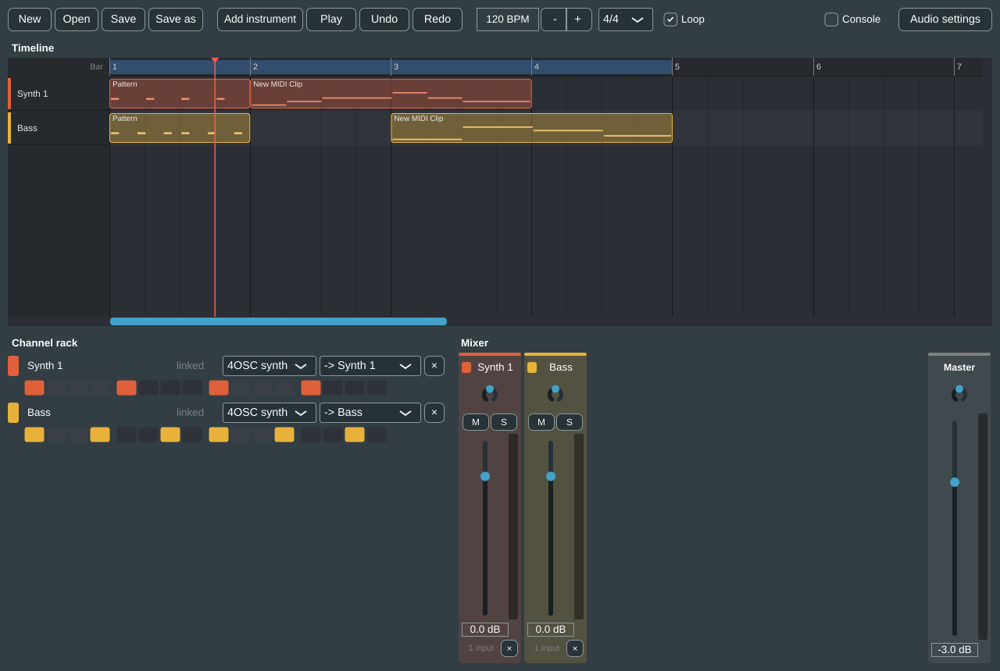

# Ng DAW user guide

Ng DAW is a desktop DAW built on Tracktion Engine and JUCE. It works like FL Studio (a channel
rack with step patterns, a playlist-style timeline with paint/slice/delete/mute tools, a piano
roll) and has a REAPER/Cubase-style mixer. Every change you make in the window is a named command,
and AI tools such as Claude can run the same commands. See [the command reference](../commands.md)
and [the MCP server](../mcp.md).

## Pages

| Page | What it covers |
| --- | --- |
| [Getting started](getting-started.md) | Installing on Windows, the `.ngdaw` file association, first launch, the main window layout, and project files: new/open/save, autosave and crash recovery. |
| [Playing and recording](playing-and-recording.md) | The transport (play, tempo, time signature, loop, metronome), arming channels, MIDI keyboards, the typing keyboard and on-screen piano, and recording MIDI and audio. |
| [The timeline](timeline.md) | Lanes and clips, the Paint/Slice/Delete/Mute tools, selecting, moving, trimming and copying clips, audio clips and fades, the loop region, zoom and scroll, and automation lanes. |
| [The piano roll](piano-roll.md) | Drawing and editing notes, the velocity lane, snap and quantize, ghost notes, and key/scale highlighting. |
| [Channel rack and mixer](channel-rack-and-mixer.md) | Channels, instruments and step patterns, multiple patterns, the mixer strips, routing, buses and sends, insert effects, VST3 plugins and plugin windows. |
| [Samples](samples.md) | The browser panel, sample folders and search, audio channels, the sample editor (stretch, pitch, tempo, length) and the sampler instrument. |
| [Exporting](export.md) | Exporting the whole song or the loop region to WAV or MP3, exporting stems, and setting up an MP3 encoder. |
| [Panels and preferences](panels-and-preferences.md) | Docking and detaching panels, the command palette, undo history, the command console and AI command log, the CPU meter, and the Settings window (audio/MIDI, theme, project folder, autosave, AI). |
| [Keyboard shortcuts](keyboard-shortcuts.md) | Every keyboard shortcut and mouse gesture in one place. |

## Conventions

- **Ctrl** means Ctrl on Windows and Linux and Cmd on macOS. The app labels its shortcuts the same
  way, so on a Mac the menus show `Cmd+S` where this guide says `Ctrl+S`.
- **Right-click** also means Ctrl+click on a one-button Mac mouse, as anywhere else in JUCE apps.
- **Undo step.** Most edits are one undo step each. A whole drag (a fader move, painting several
  clips, deleting several notes with a right-drag) is also one undo step. A few things are not
  undo steps at all: mute and solo, folding mixer strips, and view settings such as zoom.
- **Typing keyboard.** The typing keyboard is **on** by default. While it is on, the letter keys
  that play notes (Z S X D C V G B H N J M, Q 2 W 3 E R 5 T 6 Y 7 U I 9 O 0 P and some punctuation)
  play the armed channel and do *not* run their single-key shortcuts (B, C, D, T, S, R, Q).
  Turn it off with **Ctrl+K** to use those shortcuts. Shortcuts with Ctrl or Alt always work.
  See [Playing and recording](playing-and-recording.md#the-typing-keyboard).
