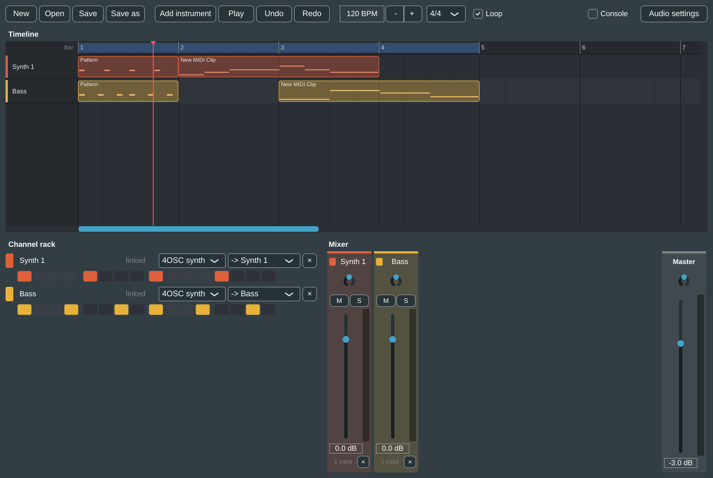

# Getting started

## Installing

### Windows

1. Download `NgDaw-<version>-Windows-Setup.exe` from the
   [releases page](https://github.com/nicolaigoon/ng-audio/releases).
2. Run it. The installer is 64-bit only. It can install for all users (in `C:\Program Files\Ng DAW`)
   or, if you choose so in its first dialog, just for you.
3. On the *Select Additional Tasks* page:
   - **Create a desktop shortcut** is off by default.
   - **Open .ngdaw projects with Ng DAW** (under *File types*) is on by default. Leave it on to
     open projects by double-clicking them in Explorer.
4. When it finishes, you can launch Ng DAW straight away.

The installer adds two programs: **Ng DAW** (`Ng DAW.exe`) and **NgDawMcp** (`NgDawMcp.exe`), the
MCP server that lets Claude and other AI clients work on the open project (see
[the MCP guide](../mcp.md)). It also adds a Start menu folder with *Ng DAW* and *Uninstall Ng DAW*.
You don't need to install anything else. The one optional extra is an MP3 encoder for MP3 export
(see [Exporting](export.md#mp3-export)).

Uninstalling removes the program and the `.ngdaw` association. It leaves your projects, settings
and presets alone.

### macOS and Linux

There is no installer for these yet. Build from source as described in
[Building](../building.md).

## Opening projects from Explorer

With the file association on, double-clicking a `.ngdaw` file opens it in Ng DAW. If Ng DAW is
already running, it opens the project in that window (after asking about unsaved changes) instead
of starting a second copy. You can also pass a project path on the command line:

```
"C:\Program Files\Ng DAW\Ng DAW.exe" "D:\Music\My song.ngdaw"
```

## First launch

A splash window with animated level bars shows progress while the audio engine starts
("Starting the audio engine", "Opening the project", "Ready"), then fades out over the main
window.

Ng DAW always starts with a small starter project: one channel, **Synth 1**, playing Tracktion's
built-in 4OSC synth with a four-on-the-floor step pattern. Press **Space** to hear it. The starter
project has no unsaved changes and nothing to undo.

The first time, check your audio device in **Settings** (the gear button at the top right, or
**Ctrl+,**) > **Audio and MIDI**. See [Panels and preferences](panels-and-preferences.md#settings).

The window remembers its size and position (including maximised) between runs. The smallest
it can be is 900 x 560 pixels.

## The main window



From top to bottom:

### The top bar

From left to right:

| Item | What it does |
| --- | --- |
| **Menus**: File, Edit, View, Options, Help | Every app action, with its shortcut. See [the menus](#the-menus) below. |
| **New**, **Open**, **Save** buttons | Project files. These are hidden when the window is narrower than 1320 pixels; the File menu still has them. |
| **Undo**, **Redo** | Greyed out when there's nothing to undo or redo. |
| **Back to the start** (`|<`) | Moves the playhead to the start (**Home**). |
| **Play / Stop** | Starts or stops playback (**Space**). |
| **Record** | Records into the armed channels (**R**). |
| **Tempo** | 20 to 300 BPM. Type a value, click the arrows, or drag up and down. |
| **Time signature** | 2/4, 3/4, 4/4, 5/4, 6/8, 7/8 or 12/8. |
| **Song position** | Bar . beat . sixteenth. |
| **Loop** | Turns looping on or off (**Ctrl+L**). |
| **Metronome** | Turns the click on or off (**Ctrl+M**). |
| **Typing keyboard** | Plays the armed channel from the computer keyboard (**Ctrl+K**). |
| **Piano keyboard** | Shows an on-screen piano along the bottom of the window (**Ctrl+Shift+K**). |
| **CPU** meter | How hard the audio engine is working. See [the CPU meter](panels-and-preferences.md#the-cpu-meter). |
| **Browser** | Shows or hides the browser on the left (**Ctrl+B**). |
| **Console** | Shows or hides the command console and the AI command log. |
| **History** | Opens the undo history (**Ctrl+H**). |
| **Export** | Opens the Export dialog (**Ctrl+E**). |
| **Settings** | Opens Settings (**Ctrl+,**). |
| **?** | Lists the keyboard shortcuts (**F1**). |

Hover over any button to see a tooltip with what it does and its shortcut.

### The panels

Below the top bar:

- **Browser** (left): instruments, effects, presets and sample folders to drag in.
  See [Samples](samples.md#the-browser).
- **Timeline** (top): the arrangement. One lane per channel. See [The timeline](timeline.md).
- **Channel rack** (bottom left): the channels, their instruments and step patterns.
  See [Channel rack and mixer](channel-rack-and-mixer.md#the-channel-rack).
- **Mixer** (bottom right): the mixer strips and the master.
  See [Channel rack and mixer](channel-rack-and-mixer.md#the-mixer).
- **Piano roll** and **Sample editor**: when you open a MIDI clip or an audio clip, its editor
  takes the place of the rack and mixer until you close it (**Esc** or its × button).
  Only one editor is open at a time.
- **Command console** and **AI command log** (along the bottom, hidden at first).
- **On-screen piano** (along the very bottom, hidden at first).

Drag the bars between panels to resize them and double-click a bar to reset it. You can also
detach any panel into its own window. See [Panels and preferences](panels-and-preferences.md#arranging-the-panels).

### The menus

| Menu | Items |
| --- | --- |
| **File** | New project (Ctrl+N), Open... (Ctrl+O), Save (Ctrl+S), Save as... (Ctrl+Shift+S), Import audio files... (Ctrl+I), Export... (Ctrl+E), Quit |
| **Edit** | Undo (Ctrl+Z), Redo (Ctrl+Y), History... (Ctrl+H), Add instrument (Ctrl+T), Add audio channel, Add bus |
| **View** | Browser (Ctrl+B), Typing keyboard (Ctrl+K), Piano keyboard (Ctrl+Shift+K), Command console; *Timeline / Channel rack / Mixer / Piano roll / Sample editor in its own window*; Zoom the timeline to fit the song (Ctrl + left click); Reset the layout |
| **Options** | Settings... (Ctrl+,), Plugins... |
| **Help** | Command palette (Ctrl+Shift+P), Keyboard shortcuts (F1), About Ng DAW |

Items with a tick (Browser, Typing keyboard, and so on) show whether that thing is on now.

## Project files

A project is one `.ngdaw` file. It holds the whole Tracktion Edit as XML: channels, clips, notes,
patterns, mixer strips, effects and their settings, plugin state, and automation. Audio files,
samples and recordings are **not** copied into it. The project stores where each file is, so keep
them where they are. A file that has gone missing still shows in the project and is marked
missing (in red in the sampler, and on the clip in the timeline).

| Action | Shortcut | Notes |
| --- | --- | --- |
| **New project** | Ctrl+N | Asks about unsaved changes first, then opens a new starter project (Synth 1 with a four-on-the-floor pattern). |
| **Open...** | Ctrl+O | Asks about unsaved changes, then shows a file chooser for `*.ngdaw`. It starts in the current project's folder, or the [project folder](panels-and-preferences.md#general). |
| **Save** | Ctrl+S | Saves to the current file. A project that has never been saved asks for a name, as Save as does. |
| **Save as...** | Ctrl+Shift+S | Suggests the project's name in its folder, warns before overwriting, and adds `.ngdaw` if you leave it off. |

The **window title** shows the project name, with a `*` while there are unsaved changes, for
example `My song* - Ng DAW`. An unsaved project is called *Untitled*.

**Unsaved changes.** New, Open, opening a project from Explorer, and closing the app all ask
*Save the changes to "..." first?* with **Save**, **Don't save** and **Cancel**. Cancel leaves
everything as it was.

**Default folder.** New projects are saved in the project folder, which is `Music/Ng DAW` unless
you choose another one in Settings > General. Recordings and exports also go there until the
project is saved. After that they go beside the project: `Recordings/` and `Exports/` next to the
`.ngdaw` file.

**Plugins that aren't installed.** A project that uses a VST3 plugin this computer doesn't have
still opens. The plugin is kept, marked *(missing)*, so its settings aren't lost if you open the
project again where it is installed.

## Autosave and crash recovery

While the project has unsaved changes, Ng DAW saves a copy of them in the background, every
minute by default. The copy goes to the `Autosave` folder in Ng DAW's settings folder
(`%APPDATA%\Ng DAW\Autosave` on Windows, `~/Library/Application Support/Ng DAW/Autosave` on macOS,
`~/.config/Ng DAW/Autosave` on Linux), never over your project file.

- Change how often it saves, or turn it off, in **Settings > General > Autosave**: Off, every
  minute, or every 2, 5 or 10 minutes.
- Autosave waits while you are recording or exporting, and tries again shortly after.
- Saving the project, starting a new one or opening another removes the autosaved copy.

If Ng DAW closes without saving (a crash or a power cut), the next start asks
**Recover unsaved changes?**, naming the project and when the copy was made:

| Button | What happens |
| --- | --- |
| **Recover** | Opens the recovered changes as an **unsaved** project, so you can look before you save over the original. There's no undo history before this point. |
| **Discard** | Deletes the autosaved copy. |
| **Later** | Keeps the copy and asks again next time. |

If there are several copies from several crashes, only the newest is offered. The older ones are
deleted.
